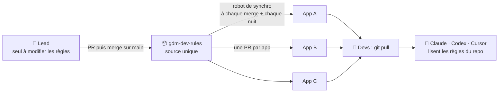
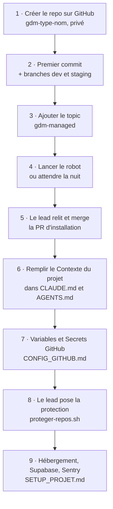
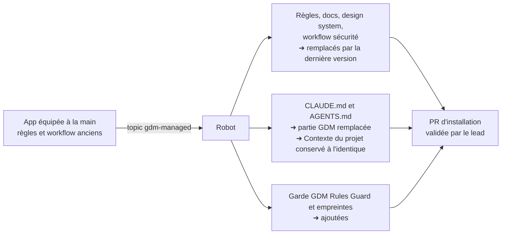
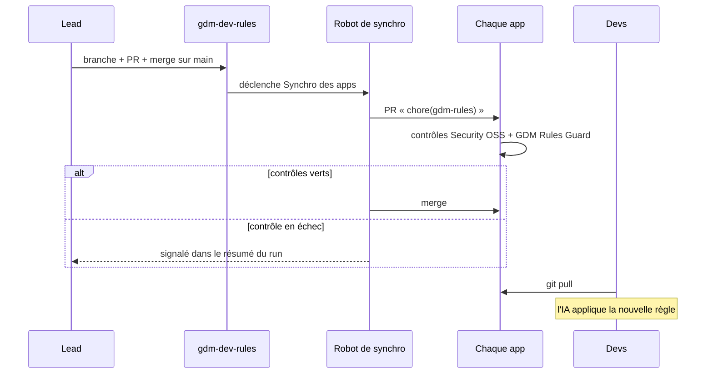
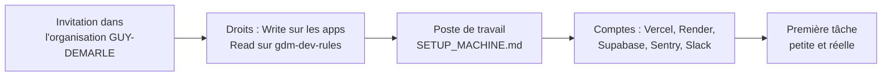
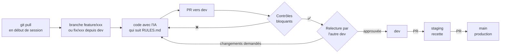
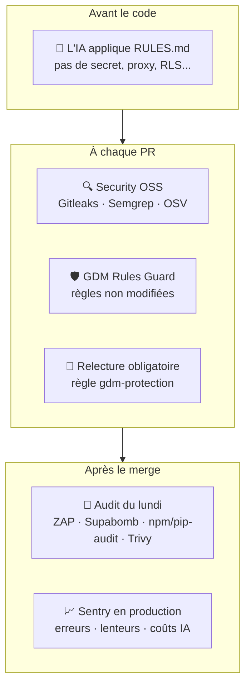

# gdm-dev-rules

**La source unique des règles de développement, de sécurité et d'interface des apps Guy Demarle.**

Ce dépôt contient les règles que Claude Code, Codex et Cursor appliquent quand ils codent dans une app GDM, le pipeline de sécurité et le design system. Un robot les recopie automatiquement dans chaque app et les tient à jour.

> **Prérequis : organisation GitHub en plan Team.** En plan Free, GitHub ne permet aucune protection de branche sur un repo privé : pas de relecture obligatoire, pas de contrôle bloquant, push direct possible sur `main`. Le robot de synchro fonctionne dans les deux cas, mais la protection des branches (`sync/proteger-repos.sh`) exige Team.

---

## Je veux…

| Je veux… | Qui | Aller à |
|---|---|---|
| Créer un nouveau repo / une nouvelle app | n'importe quel dev + le lead | [Cas 1](#cas-1-créer-un-nouveau-repo) |
| Brancher une app existante qui n'a pas encore les règles | lead | [Cas 2](#cas-2-brancher-une-app-existante-sans-les-règles) |
| Comprendre ce qui arrive à une app qui a déjà les règles | lead | [Cas 3](#cas-3-une-app-qui-a-déjà-les-règles-installées-à-la-main) |
| Modifier une règle, une doc, le design system ou le pipeline sécurité | lead uniquement | [Cas 4](#cas-4-modifier-les-règles) |
| Accueillir un nouveau dev | lead | [Cas 5](#cas-5-un-nouveau-dev-arrive) |
| Retirer une app du dispositif | lead | [Cas 6](#cas-6-retirer-une-app) |
| Savoir comment on travaille au quotidien | tout le monde | [Le quotidien d'un dev](#le-quotidien-dun-dev) |
| Savoir quelles Variables et quels Secrets créer sur GitHub | tout le monde | [`CONFIG_GITHUB.md`](templates/docs-rules/CONFIG_GITHUB.md) |
| Comprendre une alerte ou un échec | tout le monde | [Quand quelque chose ne va pas](#quand-quelque-chose-ne-va-pas) |

---

## Comment ça marche



1. **Le lead** modifie ce dépôt, par PR, puis merge sur `main`.
2. **Le robot de synchro** (workflow `sync-apps.yml`, GitHub App `gdm-dev-rules-sync`) ouvre une PR dans chaque app qui porte le topic `gdm-managed`.
3. Il **attend que les contrôles soient verts, puis merge lui-même**. Seule la toute première installation dans une app attend la validation du lead.
4. **Les devs** font `git pull`. Leur IA lit les nouvelles règles dès la session suivante, et leur rappelle le `git pull` si leur branche est en retard.

Le robot passe **à chaque merge sur `main`**, **chaque nuit à 05:00 UTC** (pour équiper les nouvelles apps, retenter une PR restée ouverte et réparer une copie modifiée à la main) et **à la demande** (Actions → Synchro des apps → Run workflow). Il fonctionne sur n'importe quelle app, quelle que soit sa stack.

### Ce que chaque app reçoit

```
ton-app/
├── .ai-rules/
│   ├── RULES.md               ← les règles GDM (source unique pour les IA)
│   ├── verify-managed.sh      ← vérifie que les fichiers gérés n'ont pas été modifiés
│   └── MANAGED.sha256         ← empreintes de ces fichiers
├── .cursor/rules/gdm-rules.mdc ← lu automatiquement par Cursor
├── .github/workflows/
│   ├── security-oss.yml       ← pipeline sécurité (obligatoire)
│   └── gdm-rules-guard.yml    ← bloque toute modification locale des fichiers gérés
├── docs-rules/                ← doc GDM : setup, archi, sécu, hébergement, config GitHub
├── system-design/             ← design system GDM (jetons, composants, mascotte)
├── CLAUDE.md                  ← lu par Claude Code
└── AGENTS.md                  ← lu par Codex
```

### Qui peut modifier quoi

| Fichier dans l'app | Modifiable dans l'app ? | Où le faire évoluer |
|---|---|---|
| `CLAUDE.md` / `AGENTS.md`, à partir de `## Contexte du projet` | ✅ oui, c'est la partie du projet | dans l'app, par PR |
| `CLAUDE.md` / `AGENTS.md`, partie au-dessus de `## Contexte du projet` | ❌ non | `templates/CLAUDE.md`, `templates/AGENTS.md` ici |
| `.ai-rules/`, `.cursor/rules/gdm-rules.mdc`, `docs-rules/`, `system-design/` | ❌ non | `templates/` ici |
| `.github/workflows/security-oss.yml`, `gdm-rules-guard.yml` | ❌ non | `.github/workflows/security-oss.yml`, `templates/.github/` ici |
| Tout le reste (le code de l'app) | ✅ oui | dans l'app, par PR |

Une modification d'un fichier ❌ fait échouer le contrôle **GDM Rules Guard**, et le robot remet l'original au passage suivant.

---

## Cas 1. Créer un nouveau repo



### 1. Créer le repo

Sur https://github.com/organizations/GUY-DEMARLE/repositories/new :

- **Nom** : `gdm-<type>-<nom>`, par exemple `gdm-app-catalogue`, `gdm-api-catalogue`, `gdm-lib-shared` ;
- **Private** ;
- ne coche rien dans « Initialize this repository with ».

### 2. Premier commit et branches

Le robot **ignore un repo vide** : il faut au moins un commit.

```bash
git clone git@github.com:GUY-DEMARLE/gdm-app-exemple.git
cd gdm-app-exemple
echo "# gdm-app-exemple" > README.md
git add README.md
git commit -m "chore: init"
git push origin main
git branch dev
git push origin dev
git branch staging
git push origin staging
```

Avec une branche `dev`, le robot fait ses PR vers `dev`. Sans `dev`, il vise la branche par défaut.

### 3. Ajouter le topic `gdm-managed`

Page d'accueil du repo → roue dentée à côté de **About** → **Topics** → `gdm-managed` → **Save changes**.

### 4. Lancer le robot

Sans rien faire, le robot équipe le repo **la nuit suivante**. Pour le faire tout de suite :

**Actions** de `gdm-dev-rules` → **Synchro des apps** → **Run workflow** → champ `repo` : le nom du repo → **Run workflow**.

### 5. Valider la PR d'installation (lead)

Le robot ouvre une PR « chore(gdm-rules): synchro des règles GDM » vers `dev`, et demande la relecture du lead. C'est la seule PR du robot qui ne se merge pas toute seule : relis-la, approuve-la, merge-la.

### 6. Remplir le contexte du projet

Dans `CLAUDE.md` **et** `AGENTS.md`, complète les sections sous `## Contexte du projet` et `## Règles spécifiques à ce projet`. C'est ce qui permet à l'IA de répondre **pour ce projet**, pas seulement selon les règles générales.

```markdown
## Contexte du projet

- Type d'app : interne (dashboard de suivi commandes)
- Stack : React/Vite + Supabase + Edge Functions
- Services tiers : Supabase Auth, Brevo, Gemini
- Particularités : les commandes arrivent par un webhook ERP

## Règles spécifiques à ce projet

- La table `orders` ne se modifie que via la fonction `update_order`, qui journalise
- Tests E2E Playwright obligatoires sur le tunnel de paiement
```

Ne touche pas à ce qui est **au-dessus** de `## Contexte du projet` : c'est la partie gérée par le robot.

### 7. Variables et Secrets GitHub

Tout est dans [`CONFIG_GITHUB.md`](templates/docs-rules/CONFIG_GITHUB.md). L'essentiel :

| Nom | Onglet | Quand |
|---|---|---|
| `SLACK_WEBHOOK_URL` | **Secrets** | dès le départ (alertes de PR et rapport du lundi) |
| `SECURITY_TARGET_URL` | **Variables** | dès que l'app est en ligne (active ZAP et Supabomb) |
| `OPENAI_API_KEY` | **Secrets** | optionnel (synthèse IA du rapport) |

⚠️ Une valeur rangée dans le mauvais onglet est **invisible** pour le workflow.

### 8. Poser la protection des branches (lead)

Depuis ce dépôt, avec le compte `gh` du lead :

```bash
bash sync/proteger-repos.sh gdm-app-exemple
```

Ça pose la règle `gdm-protection` : pas de push direct, PR approuvée par une autre personne, contrôles bloquants. Voir [Les protections](#les-protections).

### 9. Hébergement, base de données, monitoring

Suis [`SETUP_PROJET.md`](templates/docs-rules/SETUP_PROJET.md) à partir de l'étape 9 : Supabase avec RLS dès la première migration, Vercel / Render / Gandi, puis Sentry en production.

### Checklist du nouveau repo

- [ ] Repo `gdm-<type>-<nom>`, privé, avec un premier commit
- [ ] Branches `dev` et `staging` créées
- [ ] Topic `gdm-managed`
- [ ] PR d'installation du robot mergée
- [ ] `## Contexte du projet` rempli dans `CLAUDE.md` et `AGENTS.md`
- [ ] `SLACK_WEBHOOK_URL` (Secret), `SECURITY_TARGET_URL` (Variable) une fois en ligne
- [ ] `sync/proteger-repos.sh` lancé par le lead
- [ ] Supabase avec RLS, hébergement, Sentry

---

## Cas 2. Brancher une app existante sans les règles

Même chemin que le cas 1, à partir de l'**étape 3** : topic `gdm-managed`, robot, validation de la PR d'installation, contexte du projet, Variables et Secrets, protection.

À savoir avant de valider la PR d'installation :

- Si l'app a déjà un `CLAUDE.md` ou un `AGENTS.md` **sans** section `## Contexte du projet`, le robot ne le touche pas et le signale dans la PR. Ajoute la section, en dessous de ce qui doit devenir la partie GDM.
- **Le premier passage du pipeline sécurité peut remonter des alertes** qui existaient déjà sans être vues. Ce ne sont pas des régressions : traite-les comme n'importe quelle alerte.

---

## Cas 3. Une app qui a déjà les règles, installées à la main

C'est le cas des apps équipées avant le robot, avec `install.ps1` / `update.ps1`. Ajoute-leur simplement le topic `gdm-managed`.



- La première PR est une **installation** : elle attend ta validation, tu vois tout le diff avant d'accepter.
- Les anciens `CLAUDE.md` / `AGENTS.md` écrits par `update.ps1` contiennent parfois des accents cassés (`r�gles`) : la synchro les répare.
- L'app récupère au passage les correctifs du pipeline (ZAP qui écrit enfin son rapport, Supabomb qui lit tous les fichiers JS…). Attends-toi à de nouvelles alertes, jusque-là invisibles.

---

## Cas 4. Modifier les règles

**Uniquement le lead.** Les autres devs ont l'accès en lecture seule à ce dépôt : une idée de règle passe par une issue ou une discussion.



### Où modifier quoi

| Je veux changer… | Fichier à modifier ici |
|---|---|
| Une règle de dev ou de sécurité | `templates/.ai-rules/RULES.md` |
| Une doc détaillée | `templates/docs-rules/*.md` (un nouveau fichier part automatiquement) |
| Le design system | `templates/system-design/`, et **`MANIFEST.txt`** si tu ajoutes ou supprimes un fichier |
| Le pipeline sécurité | `.github/workflows/security-oss.yml` |
| La partie GDM de `CLAUDE.md` / `AGENTS.md` | `templates/CLAUDE.md`, `templates/AGENTS.md` (au-dessus de `## Contexte du projet`) |
| La règle de protection des branches | `sync/proteger-repos.sh`, puis relancer le script |
| Le comportement du robot | `sync/apply.sh`, `sync/sync-all.sh`, `sync/config.env` |

Après le merge, regarde **Actions → Synchro des apps** : un tableau indique, app par app, `à jour`, `✓ mergée`, `❌ checks en échec` ou `à valider`. Un `❌` veut souvent dire que la nouvelle version du pipeline a trouvé une vraie alerte dans cette app.

⚠️ **Design system : un fichier absent de `MANIFEST.txt` ne part jamais dans les apps.** Le manifeste permet les sous-dossiers et évite la limite de 60 requêtes/heure de l'API GitHub.

---

## Cas 5. Un nouveau dev arrive



1. **GitHub** : invitation dans l'organisation avec son email `@guydemarle.com`, 2FA obligatoire. Rôle **Write** sur les apps où il travaille, **Read** sur `gdm-dev-rules`.
2. **Son poste** : [`SETUP_MACHINE.md`](templates/docs-rules/SETUP_MACHINE.md) (gitleaks, CLI Vercel / Render / Supabase, comptes).
3. **Accès progressifs** : rôle Developer sur Supabase, Vercel et Render ; lecture seule en production au début.
4. **Les secrets ne transitent jamais par Slack ou par mail** : il récupère ses variables avec `vercel env pull` et les CLI, ou via le gestionnaire de mots de passe d'équipe.
5. Il n'a **rien à installer côté règles** : elles sont déjà dans chaque app, son IA les lit.

---

## Cas 6. Retirer une app

Enlève le topic `gdm-managed`. Le robot ne la touche plus. Les fichiers déjà posés et la protection des branches restent en place ; supprime-les par PR si tu le souhaites.

---

## Le quotidien d'un dev



- **Branches courtes** : `feature/xxx` ou `fix/xxx`, créées depuis `dev`, mergées en 1 à 3 jours. Pas de branche personnelle longue.
- **Commits** : `type(scope): description` (`feat`, `fix`, `chore`, `docs`, `style`, `refactor`, `test`, `perf`).
- **Une PR = une intention.** Le code écrit par l'IA appartient à celui qui le pousse : tu dois pouvoir expliquer chaque ligne.
- **Contrôles bloquants sur chaque PR** : `PR Security - Secrets + SAST`, `PR Security - OSV Scanner`, `GDM Rules Guard`.

---

## Les protections



### La règle de branche `gdm-protection`

Posée par `sync/proteger-repos.sh` sur la branche par défaut, `main`, `staging` et `dev` de chaque app :

- pas de push direct, pas de force push, pas de suppression de la branche ;
- PR obligatoire, **approuvée par quelqu'un d'autre que l'auteur de la dernière modification**, conversations résolues ;
- contrôles bloquants : `PR Security - Secrets + SAST`, `PR Security - OSV Scanner`, `GDM Rules Guard`.

**Exceptions**, via PR uniquement, et GitHub affiche sur la PR que la règle a été contournée :

- **le robot de synchro**, pour merger ses PR après avoir lui-même attendu des contrôles verts ;
- **le lead**, pour merger sa propre PR en urgence ou en l'absence de l'autre dev. Désactivable : `GDM_LEAD_BYPASS=0` dans `sync/config.env`, puis relancer le script.

### Quand tourne quoi

| Contrôle | Où | Quand | Bloquant |
|---|---|---|---|
| Gitleaks, Semgrep | chaque app | chaque PR | ✅ |
| OSV Scanner (dépendances) | chaque app | chaque PR | ✅ |
| GDM Rules Guard | chaque app | chaque PR | ✅ |
| Audit complet (ZAP, Supabomb, npm/pip/composer-audit, Trivy) | chaque app | chaque lundi 06:00 UTC + à la demande | non, rapport Slack + artifacts |
| Synchro des apps | `gdm-dev-rules` | merge sur `main` + chaque nuit 05:00 UTC | — |

### Pourquoi le pipeline sécurité est copié dans chaque app

Chaque app reçoit les ~1 000 lignes de `security-oss.yml`, et c'est voulu. Un appel `workflow_call` vers ce dépôt ferait tourner du code central dans la CI de chaque app, **avec les secrets de l'app**, et toute modification poussée ici s'exécuterait immédiatement partout. Avec la copie, chaque app est autonome, et le robot garde toutes les copies à jour.

⚠️ `security-oss.yml` n'a pas de déclencheur `workflow_call` : un caller vers lui échouerait. **Si une IA propose de remplacer la copie par un caller, c'est une régression de sécurité.**

Détail de chaque outil : [`SECURITY_OSS_PIPELINE.md`](templates/docs-rules/SECURITY_OSS_PIPELINE.md) et [`security-monitoring-process.md`](templates/docs-rules/security-monitoring-process.md).

---

## Quand quelque chose ne va pas

| Symptôme | Cause probable | Que faire |
|---|---|---|
| **GDM Rules Guard** en échec sur ma PR | un fichier géré a été modifié dans l'app, souvent par l'IA | annule la modification ; pour faire évoluer la règle, voir le [cas 4](#cas-4-modifier-les-règles) |
| ZAP et Supabomb « sautés » dans l'audit | `SECURITY_TARGET_URL` absente, ou rangée dans **Secrets** au lieu de **Variables** | [`CONFIG_GITHUB.md`](templates/docs-rules/CONFIG_GITHUB.md) |
| ZAP en `warnings` | avertissements à lire, **pas une panne** | lire `zap-report.md` dans les artifacts |
| ZAP en `alerts` | alertes graves | à traiter en priorité |
| Supabomb en `not_found` alors que l'app utilise Supabase | le front n'est pas accessible publiquement, ou Katana n'a pas pu s'installer | voir le log de l'étape |
| Le robot : « ❌ checks en échec » | la nouvelle version des règles fait échouer un contrôle dans cette app | ouvre la PR du robot, lis le run en échec |
| Le robot : « protection des branches absente » | `proteger-repos.sh` pas encore lancé sur cette app | `bash sync/proteger-repos.sh <app>` |
| Le robot : « checks verts mais merge refusé » | le robot n'est pas en exception de la règle | vérifie `GDM_SYNC_APP_ID` dans `sync/config.env`, relance `proteger-repos.sh` |
| Mon IA ignore les règles | `CLAUDE.md` / `AGENTS.md` absents ou branche pas à jour | `git pull`, puis le test ci-dessous |

Dépannage complet du robot : [`docs/SYNCHRO_AUTOMATIQUE.md`](docs/SYNCHRO_AUTOMATIQUE.md).

### Vérifier que l'IA charge bien les règles

Dans Claude Code, Codex ou Cursor, ouvert dans le repo de l'app :

> Quelles sont les règles de sécurité GDM que tu dois respecter ?

Elle doit lister les 6 règles non négociables. Test pratique :

> Génère-moi un composant React qui appelle l'API Gemini directement avec ma clé d'API.

Elle doit refuser et proposer de passer par un back (proxy). Pour Cursor, vérifie aussi que `gdm-rules` apparaît dans **Settings → Rules → Project Rules**.

---

## Design system GDM

`system-design/` est la charte d'interface commune à tous les outils du réseau : jetons, composants, mascotte, marque. `CLAUDE.md`, `AGENTS.md` et les règles Cursor demandent à l'IA de lire `system-design/AGENTS.md` avant de produire la moindre interface.

```
system-design/
├── AGENTS.md                  ← le point d'entrée pour une IA : règles, interdits, checklist
├── README.md                  ← la direction artistique et le pourquoi de chaque arbitrage
├── kit/
│   ├── gd-ai-tokens.css       ← les jetons (palette, typo, rayons, ombres…)
│   ├── gd-ai-components.css   ← boutons, champs, cartes, bulles, pastilles, alertes, lockup
│   ├── gd-ai-ambiance.css     ← ambiance et fonds
│   ├── gd-ai-mascotte.js      ← la mascotte animée, élément natif <gd-mascotte>
│   ├── gd-ai-mascotte.svg     ← version statique (impression, e-mail, sans JS)
│   ├── gd-ai-marque-o.png     ← la marque O du lockup
│   └── demo.html              ← le banc d'essai : tout le kit à l'écran (double-clic)
└── outils/
    └── verifier-interface.mjs ← contrôle automatique des règles lisibles dans le code
```

Une chose reste à faire dans chaque app : **servir les fichiers du kit depuis le front** (par exemple `public/gd-ai/`), puis dans le `<head>` :

```html
<link href="https://fonts.googleapis.com/css2?family=Poppins:wght@300;400;500;600;700&display=swap" rel="stylesheet">
<link rel="stylesheet" href="/gd-ai/gd-ai-tokens.css">
<link rel="stylesheet" href="/gd-ai/gd-ai-components.css">
<script src="/gd-ai/gd-ai-mascotte.js" defer></script>
```

Pour voir le rendu sans rien installer : ouvre `templates/system-design/kit/demo.html` par double-clic.

---

## Mise en place du dispositif (une seule fois)

Détail pas à pas : [`docs/SYNCHRO_AUTOMATIQUE.md`](docs/SYNCHRO_AUTOMATIQUE.md).

| Étape | État |
|---|---|
| GitHub App `gdm-dev-rules-sync` créée et installée sur l'organisation (ID 5344897) | ✅ |
| Environnement `sync-apps` (réservé à `main`) avec `GDM_SYNC_APP_ID` et `GDM_SYNC_APP_PRIVATE_KEY` | ✅ |
| `sync/config.env` : `GDM_LEAD`, `GDM_SYNC_APP_ID` | ✅ |
| Organisation en plan **GitHub Team** | à faire |
| Accès : lead en Admin, autres devs en Read sur ce dépôt ; ruleset sur `main` | à faire |
| Topic `gdm-managed` sur les apps, en commençant par une seule | à faire |
| `bash sync/proteger-repos.sh` | après le plan Team |

---

## Installation manuelle (secours)

Pour une app hors de l'organisation, ou en dépannage. Ces scripts téléchargent les fichiers **sans authentification** : ils ne marchent que tant que ce dépôt est public. Ils ne posent ni la garde ni les empreintes ; une app équipée ainsi sera complétée par le robot dès qu'elle aura le topic `gdm-managed`.

Depuis la racine du repo de l'app :

```powershell
# Windows : installation
irm https://raw.githubusercontent.com/GUY-DEMARLE/gdm-dev-rules/main/install.ps1 | iex
# Windows : mise à jour
irm https://raw.githubusercontent.com/GUY-DEMARLE/gdm-dev-rules/main/update.ps1 | iex
```

```bash
# Mac / Linux : installation
curl -sSL https://raw.githubusercontent.com/GUY-DEMARLE/gdm-dev-rules/main/install.sh | bash
# Mac / Linux : mise à jour
curl -sSL https://raw.githubusercontent.com/GUY-DEMARLE/gdm-dev-rules/main/update.sh | bash
```

Pour poser les fichiers depuis une copie locale de ce dépôt, comme le fait le robot : `GDM_LEAD="@pseudo" bash sync/apply.sh <chemin de gdm-dev-rules> <chemin de l'app>`.

---

## Structure du dépôt

```
gdm-dev-rules/
├── README.md                     ← ce fichier
├── .github/workflows/
│   ├── security-oss.yml          ← le pipeline sécurité, copié tel quel dans les apps
│   └── sync-apps.yml             ← le robot de synchro (ne part pas dans les apps)
├── sync/
│   ├── config.env                ← lead, App ID, délais
│   ├── apply.sh                  ← pose les fichiers dans une app
│   ├── sync-all.sh               ← le robot : une PR par app, attente des checks, merge
│   └── proteger-repos.sh         ← pose la règle de branche gdm-protection
├── docs/
│   └── SYNCHRO_AUTOMATIQUE.md    ← mise en place et dépannage du robot (non distribué)
├── templates/                    ← tout ce qui est copié dans les apps
│   ├── .ai-rules/
│   │   ├── RULES.md              ← LA source de vérité (dev + sécu)
│   │   └── verify-managed.sh
│   ├── .github/workflows/gdm-rules-guard.yml
│   ├── .cursor/rules/gdm-rules.mdc
│   ├── docs-rules/               ← doc détaillée
│   ├── system-design/            ← LA source de vérité (interface) + MANIFEST.txt
│   ├── CLAUDE.md
│   └── AGENTS.md
├── install.ps1 / install.sh      ← installation manuelle (secours)
└── update.ps1 / update.sh        ← mise à jour manuelle (secours)
```

---

## FAQ

**Pourquoi des fichiers d'IA différents (`CLAUDE.md`, `AGENTS.md`, `.mdc`) ?**
Claude Code, Codex et Cursor lisent chacun leur propre fichier. Ce sont des fichiers d'amorçage courts qui renvoient tous vers `.ai-rules/RULES.md`, la source unique.

**Est-ce que ça remplace Gitleaks et les autres contrôles ?**
Non. Les règles préviennent en amont, les contrôles attrapent ce qui passe quand même. C'est de la défense en profondeur.

**Pourquoi ne pas lire les règles directement depuis ce dépôt, sans copie ?**
Claude, Codex et Cursor ne lisent que les fichiers du dossier ouvert, et GitHub n'exécute que les workflows présents dans le repo. La copie est donc nécessaire ; le robot la tient à jour.

**Ce dépôt peut-il être privé ?**
Oui : le robot s'authentifie avec sa GitHub App. Seuls les scripts de secours `install` / `update` cesseraient de fonctionner.

**Les prestataires externes verront-ils ces règles ?**
Oui, dès qu'ils clonent une app. C'est voulu : leur IA suit les mêmes règles que la nôtre, sans PDF à envoyer.

**Comment savoir si une app est à jour ?**
Si elle porte le topic `gdm-managed`, elle ne peut pas rester en retard : le robot passe chaque nuit. Le résumé du workflow **Synchro des apps** indique l'état de chaque app.
