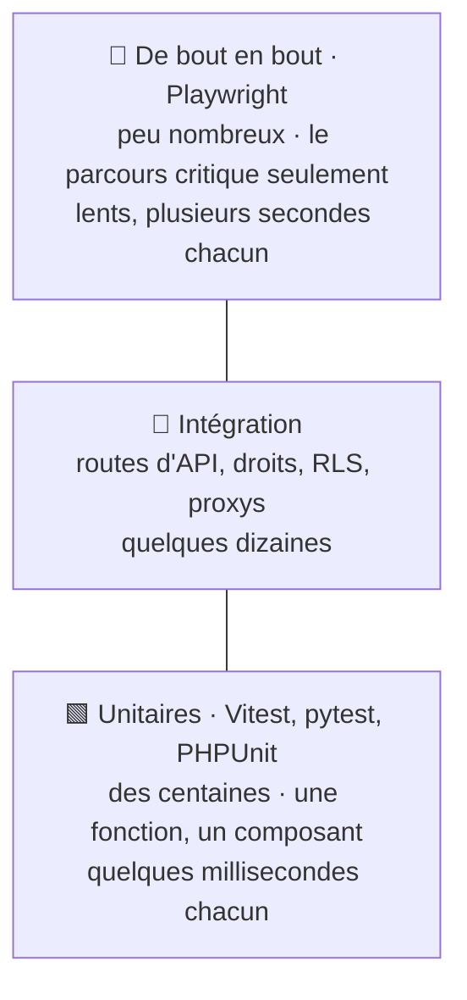
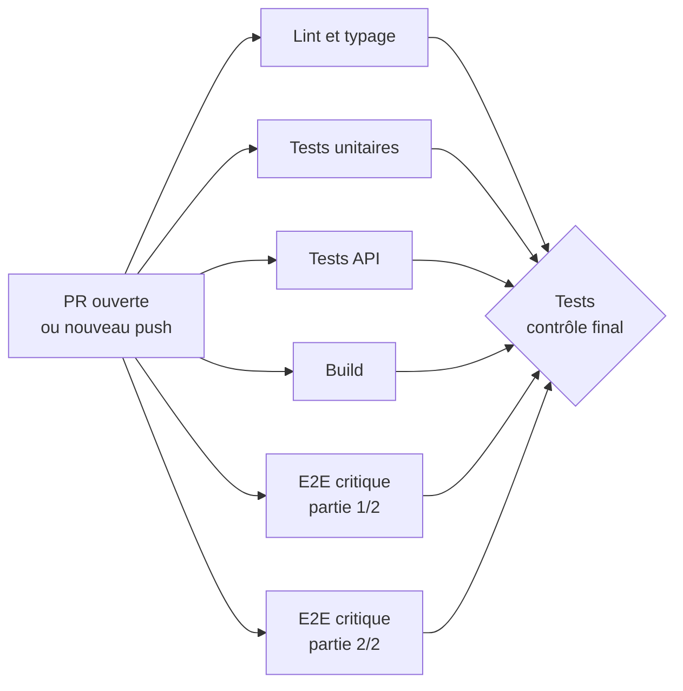

# Tests et CI — Dev GDM

**Quand utiliser ce doc** : à chaque fonctionnalité ou correctif, et pour créer ou adapter le `ci.yml` d'une app.
**Règle de référence** : `RULES.md` section 7. Ce doc donne le comment : exemples de tests et modèles de `ci.yml`.

Le code écrit avec l'IA, personne ne l'a tapé : les tests sont le moyen de le vérifier vite, et d'empêcher qu'un bug corrigé revienne.

---

## 1. Les règles en bref

| Règle | Détail |
|---|---|
| **Tests dans la même PR** | une fonctionnalité ou un correctif arrive avec ses tests |
| **Un bug = d'abord un test qui le reproduit** | il échoue avant le correctif, passe après |
| **Priorités obligatoires** | droits et authentification, RLS, proxys vers les tiers, écriture de données et argent, parcours principal |
| **Pyramide** | beaucoup de tests unitaires, des tests d'intégration sur les priorités, très peu de bout en bout |
| **Jamais affaiblir un test pour le faire passer** | ni `skip`, ni suppression, ni assertion assouplie |
| **Tests hermétiques** | pas de vraie donnée, pas de vrai secret, pas d'appel réseau réel |
| **CI de moins de 10 minutes** | jobs en parallèle, tests parallélisés, cache, timeout de 15 min par job |
| **Un contrôle final `Tests`** | c'est lui qu'on rend obligatoire dans la protection des branches |

---

## 2. La pyramide des tests



Plus on monte, plus un test est lent, fragile et coûteux à maintenir. On teste chaque comportement **au niveau le plus bas possible**.

---

## 3. Exemples de tests

### Unitaire (Vitest)

```ts
// src/lib/prix.test.ts
import { describe, it, expect } from "vitest";
import { prixTTC } from "./prix";

describe("prixTTC", () => {
  it("applique la TVA à 20 %", () => {
    expect(prixTTC(100)).toBe(120);
  });

  it("refuse un prix négatif", () => {
    expect(() => prixTTC(-1)).toThrow();
  });
});
```

### Droits d'accès sur une API (pytest)

Tester le cas autorisé **et** le cas refusé : c'est le refus qui protège.

```python
# api/tests/test_conversations.py
def test_un_utilisateur_ne_lit_pas_la_conversation_d_un_autre(client, user_a, user_b):
    conv = client.post("/conversations", headers=user_a.headers).json()

    reponse = client.get(f"/conversations/{conv['id']}", headers=user_b.headers)

    assert reponse.status_code == 404  # ni 200, ni 403 qui confirmerait l'existence


def test_sans_jeton_on_est_refuse(client):
    assert client.get("/conversations").status_code == 401
```

### Policy RLS Supabase (SQL, pgTAP)

Les fonctions `tests.*` (créer un utilisateur, se connecter en tant que…) viennent de l'extension [`supabase-test-helpers`](https://github.com/usebasejump/supabase-test-helpers), à installer une fois dans le projet de test. Sans elle, il faut créer les utilisateurs et simuler le JWT à la main.

```sql
-- supabase/tests/rls_profiles.test.sql   (lancé par : supabase test db)
begin;
select plan(2);

select tests.create_supabase_user('alice');
select tests.create_supabase_user('bob');
insert into public.profiles (id, email) values
  (tests.get_supabase_uid('alice'), 'alice@test.local'),
  (tests.get_supabase_uid('bob'),   'bob@test.local');

select tests.authenticate_as('alice');
select results_eq(
  'select count(*)::int from public.profiles',
  array[1],
  'Alice ne voit que son propre profil'
);
select is_empty(
  $$ update public.profiles set email = 'pirate@test.local'
     where id = tests.get_supabase_uid('bob') returning id $$,
  'Alice ne peut pas modifier le profil de Bob'
);

select * from finish();
rollback;
```

### Parcours critique de bout en bout (Playwright)

On marque les tests du chemin critique avec `@critique` : ce sont les seuls lancés sur chaque PR.

```ts
// e2e/connexion.spec.ts
import { test, expect } from "@playwright/test";

test("un conseiller se connecte et pose une question @critique", async ({ page }) => {
  await page.goto("/");
  await page.getByLabel("E-mail").fill("conseiller@test.local");
  await page.getByRole("button", { name: "Se connecter" }).click();
  await expect(page.getByRole("textbox", { name: "Votre question" })).toBeVisible();
});
```

Dans `playwright.config.ts`, lance l'app avant les tests et parallélise :

```ts
export default defineConfig({
  fullyParallel: true,
  workers: process.env.CI ? "100%" : undefined,
  retries: process.env.CI ? 1 : 0,  // 1 essai de plus en CI ; un test qui ne passe qu'au 2e essai est à corriger
  webServer: { command: "npm run build && npm run preview", url: "http://localhost:4173", reuseExistingServer: !process.env.CI },
  use: { baseURL: "http://localhost:4173" },
});
```

### Simuler un service tiers

On simule **la frontière** (l'appel HTTP vers Gemini, Stripe…), jamais la logique qu'on teste.

```ts
import { vi } from "vitest";

vi.spyOn(globalThis, "fetch").mockResolvedValue(
  new Response(JSON.stringify({ texte: "réponse simulée" }), { status: 200 })
);
```

---

## 4. Structure d'une CI rapide



Tous les jobs démarrent **en même temps** : la durée totale est celle du plus long, pas la somme. Le job final **`Tests`** ne fait que vérifier qu'aucun n'a échoué ; c'est le seul nom à rendre obligatoire, même si on ajoute ou renomme des jobs.

Les 6 réglages qui gardent la CI sous 10 minutes, présents dans tous les modèles :

1. `timeout-minutes` sur chaque job ;
2. jobs sans `needs` entre eux (sauf le contrôle final) ;
3. `cache: npm` / `cache: pip` ;
4. `concurrency` + `cancel-in-progress: true` ;
5. tests parallélisés : Vitest par défaut, `pytest -n auto`, `fullyParallel` + `--shard` pour Playwright ;
6. E2E de la PR limités à `@critique`, suite complète la nuit (`schedule`).

---

## 5. Modèles de `ci.yml`

Copie le modèle qui correspond à l'app dans `.github/workflows/ci.yml`, puis adapte les commandes. **Ce fichier appartient à l'app** (il n'est pas géré par le robot) : tu peux le modifier librement.

Les actions sont épinglées sur un commit précis, comme dans `security-oss.yml`.

### Modèle A — Front React/Vite ou app Node

```yaml
name: CI

on:
  pull_request:
  workflow_dispatch:
  schedule:
    - cron: "0 3 * * *" # suite E2E complète chaque nuit

concurrency:
  group: ci-${{ github.event.pull_request.number || github.ref }}
  cancel-in-progress: true

permissions:
  contents: read

jobs:
  lint:
    name: Lint et typage
    runs-on: ubuntu-latest
    timeout-minutes: 10
    steps:
      - uses: actions/checkout@11d5960a326750d5838078e36cf38b85af677262 # v4.4.0
        with:
          persist-credentials: false
      - uses: actions/setup-node@49933ea5288caeca8642d1e84afbd3f7d6820020 # v4.4.0
        with:
          node-version-file: .nvmrc
          cache: npm
      - run: npm ci
      - run: npm run lint --if-present
      - run: npm run typecheck --if-present

  unit:
    name: Tests unitaires
    runs-on: ubuntu-latest
    timeout-minutes: 10
    steps:
      - uses: actions/checkout@11d5960a326750d5838078e36cf38b85af677262 # v4.4.0
        with:
          persist-credentials: false
      - uses: actions/setup-node@49933ea5288caeca8642d1e84afbd3f7d6820020 # v4.4.0
        with:
          node-version-file: .nvmrc
          cache: npm
      - run: npm ci
      - run: npx vitest run

  build:
    name: Build
    runs-on: ubuntu-latest
    timeout-minutes: 10
    steps:
      - uses: actions/checkout@11d5960a326750d5838078e36cf38b85af677262 # v4.4.0
        with:
          persist-credentials: false
      - uses: actions/setup-node@49933ea5288caeca8642d1e84afbd3f7d6820020 # v4.4.0
        with:
          node-version-file: .nvmrc
          cache: npm
      - run: npm ci
      - run: npm run build

  # Supprime ce job tant que l'app n'a pas de tests Playwright (et retire-le de `needs` plus bas).
  e2e:
    name: E2E (${{ matrix.shard }})
    runs-on: ubuntu-latest
    timeout-minutes: 15
    strategy:
      fail-fast: false
      matrix:
        shard: ["1/2", "2/2"]
    env:
      # Sur une PR : chemin critique seulement. La nuit : suite complète.
      PW_FILTRE: ${{ github.event_name == 'schedule' && '.*' || '@critique' }}
    steps:
      - uses: actions/checkout@11d5960a326750d5838078e36cf38b85af677262 # v4.4.0
        with:
          persist-credentials: false
      - uses: actions/setup-node@49933ea5288caeca8642d1e84afbd3f7d6820020 # v4.4.0
        with:
          node-version-file: .nvmrc
          cache: npm
      - run: npm ci
      - run: npx playwright install --with-deps chromium
      - run: npx playwright test --grep "$PW_FILTRE" --shard=${{ matrix.shard }}

  tests:
    name: Tests
    if: always()
    needs: [lint, unit, build, e2e]
    runs-on: ubuntu-latest
    timeout-minutes: 2
    steps:
      - name: Tous les jobs sont-ils verts ?
        env:
          RESULTATS: ${{ join(needs.*.result, ' ') }}
        run: |
          echo "Résultats : $RESULTATS"
          case " $RESULTATS " in
            *" failure "*|*" cancelled "*) exit 1 ;;
          esac
```

> `skipped` est accepté : un job sauté volontairement ne bloque pas. Attention : `hashFiles()` n'est pas utilisable dans le `if:` d'un job, seulement dans ses étapes.

### Modèle B — API Python

```yaml
name: CI

on:
  pull_request:
  workflow_dispatch:

concurrency:
  group: ci-${{ github.event.pull_request.number || github.ref }}
  cancel-in-progress: true

permissions:
  contents: read

jobs:
  lint:
    name: Lint
    runs-on: ubuntu-latest
    timeout-minutes: 10
    steps:
      - uses: actions/checkout@11d5960a326750d5838078e36cf38b85af677262 # v4.4.0
        with:
          persist-credentials: false
      - uses: actions/setup-python@a26af69be951a213d495a4c3e4e4022e16d87065 # v5.6.0
        with:
          python-version: "3.12"
          cache: pip
      - run: pip install ruff
      - run: ruff check .

  pytest:
    name: Tests API
    runs-on: ubuntu-latest
    timeout-minutes: 15
    steps:
      - uses: actions/checkout@11d5960a326750d5838078e36cf38b85af677262 # v4.4.0
        with:
          persist-credentials: false
      - uses: actions/setup-python@a26af69be951a213d495a4c3e4e4022e16d87065 # v5.6.0
        with:
          python-version: "3.12"
          cache: pip
      - run: pip install -r requirements.txt pytest pytest-xdist
      - run: pytest -n auto -q

  tests:
    name: Tests
    if: always()
    needs: [lint, pytest]
    runs-on: ubuntu-latest
    timeout-minutes: 2
    steps:
      - name: Tous les jobs sont-ils verts ?
        env:
          RESULTATS: ${{ join(needs.*.result, ' ') }}
        run: |
          echo "Résultats : $RESULTATS"
          case " $RESULTATS " in
            *" failure "*|*" cancelled "*) exit 1 ;;
          esac
```

### Modèle C — Front et API dans le même repo (`frontend/` + `api/`)

Même principe : un job par partie, tous en parallèle. Seuls les jobs changent ; reprends `on`, `concurrency`, `permissions` et le job `tests` du modèle A.

```yaml
jobs:
  front:
    name: Front (lint, tests, build)
    runs-on: ubuntu-latest
    timeout-minutes: 10
    defaults:
      run:
        working-directory: frontend
    steps:
      - uses: actions/checkout@11d5960a326750d5838078e36cf38b85af677262 # v4.4.0
        with:
          persist-credentials: false
      - uses: actions/setup-node@49933ea5288caeca8642d1e84afbd3f7d6820020 # v4.4.0
        with:
          node-version-file: frontend/.nvmrc
          cache: npm
          cache-dependency-path: frontend/package-lock.json
      - run: npm ci
      - run: npm run lint --if-present
      - run: npx vitest run
      - run: npm run build

  api:
    name: Tests API
    runs-on: ubuntu-latest
    timeout-minutes: 15
    defaults:
      run:
        working-directory: api
    steps:
      - uses: actions/checkout@11d5960a326750d5838078e36cf38b85af677262 # v4.4.0
        with:
          persist-credentials: false
      - uses: actions/setup-python@a26af69be951a213d495a4c3e4e4022e16d87065 # v5.6.0
        with:
          python-version: "3.12"
          cache: pip
          cache-dependency-path: api/requirements.txt
      - run: pip install -r requirements.txt pytest pytest-xdist
      - run: pytest -n auto -q

  tests:
    name: Tests
    if: always()
    needs: [front, api]
    # … étapes identiques au modèle A
```

### Modèle D — App PHP

```yaml
name: CI

on:
  pull_request:
  workflow_dispatch:

concurrency:
  group: ci-${{ github.event.pull_request.number || github.ref }}
  cancel-in-progress: true

permissions:
  contents: read

jobs:
  phpunit:
    name: Tests PHP
    runs-on: ubuntu-latest
    timeout-minutes: 10
    steps:
      - uses: actions/checkout@11d5960a326750d5838078e36cf38b85af677262 # v4.4.0
        with:
          persist-credentials: false
      - uses: shivammathur/setup-php@f3e473d116dcccaddc5834248c87452386958240 # 2.37.2
        with:
          php-version: "8.3"
          tools: composer
          coverage: none
      - run: composer install --no-interaction --no-progress --prefer-dist
      - run: vendor/bin/phpunit --testdox

  tests:
    name: Tests
    if: always()
    needs: [phpunit]
    runs-on: ubuntu-latest
    timeout-minutes: 2
    steps:
      - name: Tous les jobs sont-ils verts ?
        env:
          RESULTATS: ${{ join(needs.*.result, ' ') }}
        run: |
          case " $RESULTATS " in
            *" failure "*|*" cancelled "*) exit 1 ;;
          esac
```

---

## 6. Base de données pour les tests

Les tests d'intégration et de RLS ont besoin d'une base. **Jamais la base de prod.** Deux options :

| Option | Quand | Comment |
|---|---|---|
| **Supabase local dans la CI** | recommandé : isolé, gratuit, repart de zéro à chaque run | `supabase start` (Docker est disponible sur les runners GitHub), applique les migrations du repo, puis `supabase test db` pour les tests SQL. Compte 1 à 2 minutes de démarrage. |
| **Un projet Supabase de test** | quand le local ne suffit pas | URL et clés du projet de test en **Secrets** GitHub (cf. `CONFIG_GITHUB.md`), jamais celles de prod |

---

## 7. Rendre les tests obligatoires

Quand une app a son `ci.yml` et qu'il est vert de façon stable, le lead ajoute le contrôle **`Tests`** aux contrôles obligatoires de la règle `gdm-protection`. Une PR avec des tests rouges ne pourra alors plus être mergée.

Tant qu'une app n'a pas de CI de tests, on ne l'exige pas : le contrôle n'existerait pas et bloquerait toutes les PR.

---

## 8. Checklist : ma PR est-elle prête ?

- [ ] Les nouveaux comportements ont des tests, au niveau le plus bas possible
- [ ] Un bug corrigé a son test de non-régression
- [ ] Les cas **refusés** sont testés (droits, RLS, entrées invalides)
- [ ] Aucun test n'a été supprimé, désactivé ou assoupli pour passer
- [ ] Aucune vraie donnée, aucun vrai secret, aucun appel réseau réel dans les tests
- [ ] Les tests passent en local et le contrôle `Tests` est vert
- [ ] La CI reste sous 10 minutes

---

## 9. Si quelque chose ne va pas

| Symptôme | Que faire |
|---|---|
| La CI dépasse 10 minutes | regarde le job le plus long : le découper, le paralléliser (`-n auto`, `--shard`), réduire les E2E de PR au chemin critique, vérifier le cache |
| Un test passe puis échoue sans changement (flaky) | le corriger tout de suite (attente explicite plutôt que `sleep`, données isolées, horloge simulée) ou le mettre en quarantaine avec une issue |
| Un test E2E échoue seulement en CI | télécharger la trace Playwright (`--trace on-first-retry`) dans les artifacts du run |
| L'IA propose de supprimer ou d'assouplir un test | refuser : `RULES.md` 7.3. Demander pourquoi le test échoue, corriger le code |
